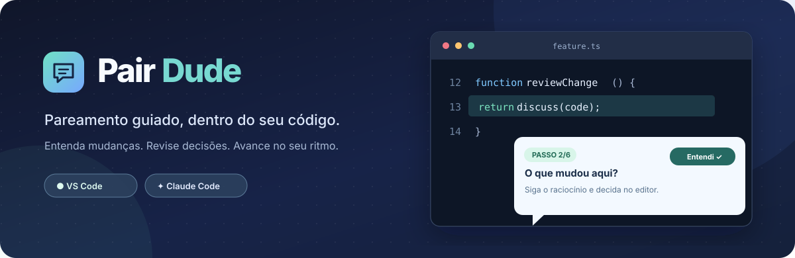
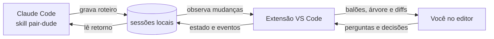

<div align="center">
  

  <p><strong>Seu roteiro de pair programming, diretamente no código.</strong></p>
  <p>Passos ancorados em trechos reais · conversa no editor · revisão, implementação e planejamento</p>

  <p>
    <a href="#-instalação">Instalar</a> ·
    <a href="#-como-funciona">Como funciona</a> ·
    <a href="#-estrutura-do-repositório">Estrutura</a> ·
    <a href="#-desenvolvimento">Desenvolver</a>
  </p>
</div>

---

## ✨ O que é

**Pair Dude** combina uma extensão do VS Code com uma skill do Claude Code. O assistente monta um roteiro; a extensão abre cada passo como um comentário no trecho correspondente do arquivo. Você pode navegar, marcar que entendeu, aprovar, pedir ajustes ou perguntar sem sair do editor.

| No editor | Na conversa |
| :--- | :--- |
| Balões ancorados no código e destaques visuais | Roteiros de revisão, explicação, implementação e planejamento |
| Árvore de passos com progresso e decisões | Respostas às perguntas feitas em cada passo |
| Diffs nativos e diagramas Mermaid | Modo didático com explicações mais granulares |

> [!NOTE]
> O Pair Dude usa o **Claude Code** para conduzir as sessões. A extensão e a skill trocam dados por arquivos locais; não há servidor próprio.

## 🚀 Instalação

**Requisitos:** VS Code 1.90+, Node.js, Claude Code e o comando `code` disponível no terminal. Para diagramas, tenha Edge ou Chrome instalado.

Clone o repositório e execute o instalador da sua plataforma:

```powershell
# Windows, a partir da raiz do repositório
powershell -ExecutionPolicy Bypass -File .\scripts\install.ps1
```

```bash
# macOS ou Linux, a partir da raiz do repositório
bash scripts/install.sh
```

O instalador registra a extensão a partir de [`dist/pair-dude.vsix`](dist/pair-dude.vsix) e copia a skill para `~/.claude/skills/pair-dude`. Recarregue a janela do VS Code e reinicie o Claude Code. Se você usava **Pair Guide**, desinstale a extensão anterior para evitar duas extensões observando as mesmas sessões.

### Comece uma sessão

Abra um projeto no VS Code e peça ao Claude Code, por exemplo:

> “Use o Pair Dude para me explicar esta mudança passo a passo.”

O roteiro aparece na barra lateral **Pair Dude → Roteiro**. Use `Ctrl+Alt+N` / `Ctrl+Alt+P` para avançar e voltar, `Ctrl+Alt+U` para marcar “Entendi” e `Ctrl+Alt+L` para escolher um passo.

## 🧭 Como funciona



Os arquivos de sessão ficam em `~/.pair-guide/sessions/`. Esse caminho e os IDs de comandos `pairGuide.*` foram mantidos para preservar compatibilidade com sessões e configurações anteriores. O nome exibido, o pacote VSIX e a skill usam **Pair Dude**. A pasta pode ser alterada em `pairGuide.dataDir` no VS Code e pela variável `PAIR_GUIDE_DIR` na skill.

| Arquivo | Quem escreve | Para que serve |
| :--- | :--- | :--- |
| `<id>.session.json` | Skill | Metadados e passos do roteiro |
| `<id>.state.json` | Extensão | Passo atual e decisões |
| `<id>.events.jsonl` | Extensão | Perguntas, respostas e navegação |

Veja o [contrato completo e as responsabilidades dos módulos](docs/ARCHITECTURE.md).

## 🗂️ Estrutura do repositório

```text
pair-dude/
├── extension/          # Extensão VS Code: módulos, manifesto e recursos
│   ├── src/            # Interface, estado, renderização, diffs e diagramas
│   ├── resources/      # Ícone e Mermaid para renderização local
│   └── scripts/        # Verificação dos módulos
├── skill/pair-dude/    # Instruções da skill e CLI de sessões
├── scripts/            # Instaladores Windows e macOS/Linux
├── dist/               # VSIX pronto para instalar
└── docs/               # Arquitetura e arte do README
```

## 🛠️ Desenvolvimento

```bash
cd extension
npm ci
npm run check
npm run package
```

`npm run package` gera `dist/pair-dude.vsix`. A CLI da skill pode ser executada com `node skill/pair-dude/scripts/pg.mjs <comando>`; use `dir`, `list` ou `validate <arquivo>` para inspecionar sessões.

O material original desta pasta continha apenas o VSIX **0.4.1**, não os arquivos TypeScript usados na compilação original. Os módulos JavaScript foram recuperados do pacote e agora ficam em `extension/src/` como código editável. O processo de empacotamento usa esses módulos diretamente; não depende de fontes TypeScript ausentes.

## 📄 Licença

O código do Pair Dude está sob a [licença MIT](LICENSE), com aviso de copyright de **Mateus Zebendo**. Você pode usar, alterar e redistribuir o projeto, inclusive comercialmente, desde que preserve o aviso de copyright e a licença nas cópias ou partes substanciais. O Mermaid incluído na extensão tem [aviso de terceiros próprio](extension/THIRD_PARTY_NOTICES.md).
